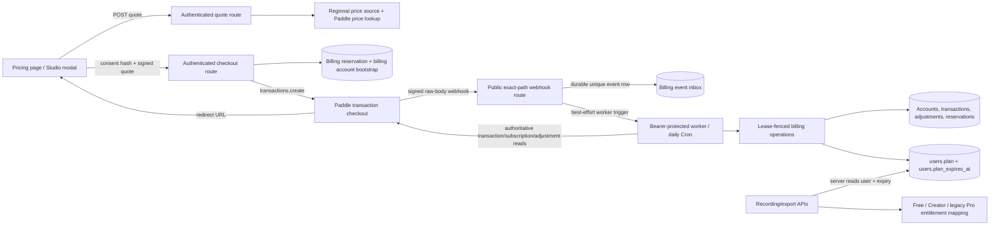

# SupersmartX Studio — Production Readiness Audit

**Audit date:** 2026-11-20  
**Repository:** `SupersmartX_Studio_V0`  
**Branch / HEAD:** `main` / `e8aadb5f8e922c1ab36cfc8280f3f844fdb5c583`  
**Mode:** read-only source review and safe local verification

## Scope and evidence limits

The supplied audit request ends during section G (“Dependency Map — Show how”). This report covers the visible instructions and includes a dependency map. The checkout was clean before inspection. I read the actual source, schema, migrations, test configuration and current Paddle migration report. I did not inspect credential values, query a database, access Vercel/deployment logs, call Paddle/Cashfree, or access production systems.

The implementation report at `docs/PADDLE_MIGRATION_IMPLEMENTATION_REPORT.md` contains historical and current-status claims, including a record that the two Paddle schema migrations were applied to production. Those statements are repository documentation only; this audit did not independently verify production state. It also contains older sections that conflict with its newer status. Treat the top “Current production-readiness review” as the document’s latest stated status, not fresh external evidence.

## A. Executive summary

**Verdict: NOT READY for live recurring billing.** The present source correctly keeps browser redirects from granting access, verifies signed Paddle webhook bodies, persists an inbox before acknowledgement, uses per-event leases, and retains current `users.plan` / `users.plan_expires_at` compatibility for Creator and legacy Pro. Local checks also pass. These safeguards do not resolve the launch blockers below.

The most serious source-level risks are concurrent grant/refund projection updates that can shorten paid coverage, regional checkout amounts that do not match the 63-country/49-currency display table, and account deletion that can remove local billing associations without stopping future Paddle billing. The landing page and refund policy still describe Creator as one-time/non-renewing, directly contradicting the recurring checkout modal.

The reported production `503` cannot be assigned an exact cause from available evidence. Several explicit 503 paths exist in the current route, but the request ID is not present in repository material and no deployment logs were available. See section F.

## B. Findings ordered by severity

### BLOCKER — Concurrent billing events can overwrite newer paid coverage

**Evidence:** `src/lib/billing/operations.ts`, `applyPaidBillingEvent` (around lines 258–412), calculates a maximum from previously read account/user dates, then writes those values; `applyAdjustmentEvent` (around lines 544–668) separately recomputes access from paid transactions and the legacy snapshot. Event leases are per event, not per account. The worker can run concurrently from webhook-triggered requests and Cron (`src/app/api/internal/paddle/worker/route.ts`).

**Failure:** two distinct paid events for the same account can be leased by overlapping worker invocations. Each transaction can read the same prior expiry; the later-period event commits first, then the earlier-period event writes its stale, smaller maximum. A simultaneous refund recalculation can race a payment grant similarly. Event-ID idempotency does not serialize distinct event IDs.

**Impact:** a customer can lose already-paid access; account and `users` projections can disagree or move backward. This is a direct entitlement-integrity failure.

**Required resolution:** serialize entitlement mutations per account (row/advisory lock or equivalent), compute the coverage maximum against locked current rows, and make projection updates monotonic except for an explicitly attributed full reversal. Add disposable-PostgreSQL concurrency tests for two renewals, renewal plus refund, and replay after crash. Do not enable live billing before these pass.

**Deferrable:** No.

### BLOCKER — Checkout price does not preserve the regional price catalog

**Evidence:** `src/lib/pricing.ts` defines 63 country entries and 49 currency codes (verified from the current source). Examples include US Creator `$7.99 / $59.99` and India `₹349 / ₹2,899`. `src/lib/billing/paddle.ts`, `getSandboxQuoteDetails` (around lines 295–319), accepts only a configured USD base and maps India to INR; every other supported country is quoted in USD at the base amount. `CheckoutQuote.currency` is restricted to `USD | INR` in `src/lib/billing/contracts.ts`.

**Failure:** a visitor in a country whose displayed pricing is local currency can reach a signed quote in USD at the US base amount. The final form displays the server quote, but the product-wide pricing cards still show the regional catalog and checkout is not an implementation of that catalog. Some users see a currency/amount change only after proceeding to the form; users in other regions are charged a different configured price than the displayed regional value.

**Impact:** incorrect customer charges, price disclosure mismatch, and the existing regional pricing/business model is not preserved. This is a launch blocker under the approved pricing constraint.

**Required resolution:** define and verify a provider eligibility map for every current country/price/currency. For unsupported currency routes, do not silently convert or substitute USD; explicitly block checkout for those regions or obtain an approved catalog strategy that preserves displayed amounts and currency. Complete sandbox price/override coverage before launch.

**Deferrable:** No for countries where the current local-price UI remains visible. A narrower launch is possible only after an approved, accurate country-availability disclosure is in place.

### BLOCKER — Customer-facing purchase and refund terms still say “one-time, no renewal”

**Evidence:** `src/app/page.tsx` FAQ (around line 107) says Creator is a one-time purchase with no automatic renewal; the pricing section (around lines 1601 and 1692–1698) repeats one-time/non-renewing language. `src/app/legal/refund/page.tsx` (around lines 47–60) says monthly/yearly fixed terms do not renew and no cancellation is needed. The Studio `PricingModal` says subscriptions renew every month/12 months until canceled (around lines 505–508, 551–569).

**Failure:** customers encounter contradictory terms before checkout and in the public pricing/refund journey.

**Impact:** users may authorize recurring billing believing they bought a one-time term; disputes, refund requests and consumer-law exposure are likely.

**Required resolution:** reconcile landing page, refund/cancellation policy, terms, FAQ, email copy and checkout disclosures with the approved subscription terms before live activation. Include renewal amount/interval, cancellation timing/access end, tax treatment, failed-payment behavior, refunds and support path.

**Deferrable:** No.

### HIGH — Account deletion does not stop a live subscription and cascades the local account

**Evidence:** `src/app/api/user/delete/route.ts` deletes user-owned data, records a tombstone and deletes the user without checking or cancelling a Paddle subscription. In `prisma/schema.prisma`, `BillingAccount` references `User` with cascade (migration `20261118000000_paddle_billing`); `BillingReservation` and `BillingOperation` also cascade from billing account. A transaction row can survive with `user_id` set null, but that does not stop remote billing or preserve all local recovery links.

**Failure:** a Creator deletes their Studio account while subscription status is active/past due. The user row and billing account are deleted while Paddle continues renewal; later webhooks cannot reliably resolve a local account/reservation owner.

**Impact:** charges can continue after account deletion, and the customer may lose access to self-service cancellation while financial evidence becomes harder to attribute.

**Required resolution:** make deletion a multi-step state machine. Before final deletion, authenticate the request, stop future renewal, confirm/reconcile the remote result, retain minimum financial/audit records under a documented retention policy, and only then remove personal/account data. If provider outcome is uncertain, hold deletion in a recoverable pending state.

**Deferrable:** No.

### HIGH — Checkout remote creation is not fully covered by durable operation recovery

**Evidence:** `src/app/api/paddle/checkout/route.ts` persists a `BillingReservation`, then calls `provider.createSandboxCheckout` (around lines 80–121). The `BillingOperation` table is used for cancellations, not checkout creation. The route updates reservation with Paddle IDs only after `transactions.create` returns. `src/app/api/paddle/checkout/status/route.ts` has bounded recovery by reservation custom data.

**Failure:** Paddle creates a transaction but the response is lost, or the subsequent reservation update fails. The browser can receive a 500 without a reservation ID; the unique active-reservation index blocks another checkout, but the customer has no ID to query the status endpoint. If the uncertain-error reservation update itself fails, the request can also escape the intended 503 branch. Recovery depends on remote listing and may require support if search is ambiguous or unavailable.

**Impact:** checkout becomes stuck or the customer retries without knowing whether a provider transaction exists. The unique reservation constraint reduces duplicate creation, but does not make the remote mutation outcome discoverable to the customer.

**Required resolution:** make reservation ID available on every post-reservation failure; persist a checkout operation intent before the remote mutation; record each outcome atomically where possible; make uncertain recovery discoverable by the authenticated account without requiring the browser to have received the ID. Test provider timeout-after-create, DB outage-after-create and ambiguous search.

**Deferrable:** No.

### HIGH — Consent evidence is a hash, not a durable consent record

**Evidence:** `PricingModal` creates a hash from plan, period, amount, currency, version and quote token (`src/components/dialogs/PricingModal.tsx`, around lines 250–270; `src/lib/billing/operations.ts`, `hashCheckoutConsent`). `BillingReservation` stores only `consentHash`, plan, period and currency (`prisma/schema.prisma`, `BillingReservation`). No consent text/version snapshot, accepted-at timestamp, or explicit accepted disclosure fields are stored. The visible CTA and static text act as implied assent; there is no separate confirmation checkbox in the form.

**Failure:** after the public disclosure text changes, support cannot reconstruct the exact text and amount the customer saw/accepted from the database evidence alone. A valid hash proves consistency of the small hashed payload, not that a particular rendered disclosure was presented and accepted at a particular time.

**Impact:** weak evidence for recurring-payment consent and dispute handling.

**Required resolution:** persist immutable, versioned disclosure/consent evidence with exact plan, interval, amount/currency, renewal terms, timestamp, account, quote and consent action. Protect it from ordinary update/delete and make the server bind checkout to it.

**Deferrable:** No.

### HIGH — Daily-only Cron cannot drain a sustained billing backlog

**Evidence:** `vercel.json` schedules the worker once daily (`0 3 * * *`). `src/app/api/internal/paddle/worker/route.ts` has `maxDuration = 60`, `BATCH_SIZE = 8`, sequential event processing and a four-minute event lease. `src/app/api/paddle/webhook/route.ts` starts a best-effort worker request with a five-second timeout after durable inbox insertion.

**Failure:** if an invocation crashes or times out with more than one batch pending and no further webhook triggers arrive, daily recovery processes at most eight events per invocation. A queue backlog can persist for many days. A single worker response also does not schedule its own next batch. Concurrent invocations can improve throughput but raise the account-level race above.

**Impact:** delayed access activation, stale payment-failure/cancellation status, unresolved refunds/disputes and growing event backlog.

**Required resolution:** retain the database inbox as the durable queue, but add bounded continuation/drain behavior or a suitable frequent scheduler/queue trigger; measure throughput vs provider rate limits and Vercel runtime; alert on oldest-event age, review state and backlog size; test overlap, timeout, outage recovery and backpressure. Confirm deployment-plan Cron limits rather than relying on an assumed schedule.

**Deferrable:** No for live event handling. An asynchronous provider webhook acknowledgement is fine only because durable inbox persistence happens first; recovery still must meet an approved service objective.

### HIGH — Cashfree pending checkouts have no current application reconciliation route

**Evidence:** current `src/app/api` contains Paddle routes but no Cashfree checkout/webhook/verification route; the source TypeScript/TSX scan found no Cashfree identifiers. Legacy `pending_orders`, `processed_webhooks`, and one-time settlement helpers remain in `src/lib/db/index.ts` and Prisma, but current application route references to `settleFulfilledOrder` were not found. `users.plan` and `users.plan_expires_at` remain the effective legacy access representation; `isCreatorPlan` retains `pro_monthly` and `pro_yearly` in `src/lib/entitlements.ts`.

**Failure:** a pre-cutover Cashfree order that settles late, or a still-pending checkout, has no active Cashfree webhook/verify route in this checkout to settle it. Existing already-granted Creator/Pro access still reads correctly, but a late valid settlement may not extend access automatically.

**Impact:** customer pays Cashfree but remains Free/expired; alternatively, operators may not be able to reconcile the legacy order from current application tools.

**Required resolution:** before launch, inventory and close/reconcile all pending Cashfree orders using an authorized legacy reconciliation procedure, preserve the records, and document who handles late settlement/refund callbacks. Do not delete historical order evidence.

**Deferrable:** The Cashfree integration itself can be retired after the pending-order window and evidence are reconciled; the reconciliation plan is not deferrable.

### HIGH — Runbook and configuration names describe a different Paddle integration

**Evidence:** `.env.example` and runtime use `PADDLE_ENVIRONMENT`, `PADDLE_API_KEY` and `PADDLE_WEBHOOK_SECRET`. `docs/PRODUCTION-RUNBOOK.md` still instructs `PADDLE_ENV`, `NEXT_PUBLIC_PADDLE_ENV`, `PADDLE_SECRET_KEY`, `PADDLE_API_VERSION`, and refers to `/api/paddle/verify`. These names/routes are not the current source contract. The implementation report contains older statements about a five-minute worker and prior lifecycle behavior superseded by its newer section.

**Failure:** an operator follows the stale runbook, sets unused variables, leaves required runtime variables absent or expects a route that no longer exists; quote/checkout/webhook calls then fail closed (often 503), and incident response looks in the wrong place.

**Impact:** prolonged checkout outage or webhook outage; possible incorrect manual operations.

**Required resolution:** make `.env.example`, `docs/ENVIRONMENT.md`, deployment/runbook instructions and implementation report agree with the current source. Add a deployment preflight that checks names/presence and environment pairing without printing values.

**Deferrable:** No before enabling billing.

### HIGH — Payment recovery and customer notification are incomplete

**Evidence:** `/api/paddle/billing` returns account and transaction facts. Header UI shows paid-through/next-charge/cancellation and sends cancellation requests, but no invoice/history screen or payment-method update interface is present. Search found no call sites for `sendPaymentConfirmationEmail`; its implementation still says “no automatic renewal”. There is no customer email dispatch from the Paddle worker for failed renewal, cancellation, refund or dispute. Failure status is visible in `ActivationModal` only for its payment-confirmation flow; recurring renewal recovery has no complete customer action path.

**Failure:** an automatic renewal fails and the customer cannot update a payment method through Studio or see a clear recovery action. They may not learn about the failure or suspension until access changes.

**Impact:** avoidable involuntary churn, support burden and unpaid use/access confusion.

**Required resolution:** decide and implement first-release notices and a payment-method recovery route that exposes only approved capabilities; provide invoice/transaction links or an explicit support path; notify before access suspension and on cancellation/refund/dispute events. Confirm provider behavior/account settings through sandbox evidence.

**Deferrable:** a full invoice browser can be deferred if provider invoice links plus transaction dates/amounts and support recovery are available. Failed-payment notification and a payment-method recovery path cannot.

### HIGH — Tax policy and regional eligibility are not launch-verified

**Evidence:** quote UI says Paddle calculates applicable tax and displays a final total (`PricingModal`, around line 569); configured Paddle prices require `taxMode: 'location'` (`src/lib/billing/paddle.ts`); paid-event validation permits tax when totals are internally consistent but verifies actual values only from future provider events. `docs/ENVIRONMENT.md` marks production tax/copy unresolved. No provider account/configuration or tax evidence was inspected.

**Failure:** taxes may be added to the stored regional amount, changing what a customer pays; provider country/currency eligibility, tax registrations, inclusive/exclusive display requirements and invoice treatment remain unproven.

**Impact:** inaccurate checkout disclosures, unsupported currency checkout, tax/compliance exposure, or a paid event entering review if provider behavior differs from mocks.

**Required resolution:** obtain tax/accounting advice and documentary evidence of current price tax basis, intended tax treatment, provider merchant-of-record scope, country/currency support and price override behavior; test a tax-bearing sandbox transaction through webhook grant. No inclusive/exclusive wording should be finalized before this.

**Deferrable:** No for each country enabled at launch.

### MEDIUM — Current UI has a cancellation status but lacks a complete billing area

**Evidence:** `src/components/layout/Header.tsx` offers “Cancel at period end” and basic status. `/api/paddle/billing` exposes up to 50 transactions, but no user-facing transaction/invoice history consumes that response. There is no Paddle portal session in this checkout, which avoids exposing unapproved portal functions.

**Failure:** users cannot review past transactions/invoices or manage payment methods from a stable Studio billing screen; cancellation confirmation can remain a terse menu state.

**Impact:** support friction and weaker billing transparency.

**Required resolution:** first release needs a stable Billing screen with active/failed/cancelled states, paid-through date, next charge, cancellation request/confirmation/uncertain recovery, transaction/invoice details and approved payment-method recovery. Keep general portal access disabled until restrictions are verified.

**Deferrable:** additional analytics, plan-change UX and tax document archive are deferrable; essential payment recovery is not.

### MEDIUM — Webhook acknowledgement can consume the provider's delivery window

**Evidence:** `src/app/api/paddle/webhook/route.ts` durably inserts the event and then awaits `triggerBillingWorker()`, whose internal fetch can wait up to five seconds. Paddle's current webhook guidance recommends responding within five seconds and handling retries. The durable inbox makes a repeated delivery idempotent, but a slow database plus the bounded worker wait can exceed that response target.

**Failure:** slow event persistence or a worker-trigger timeout delays the webhook response; Paddle may retry a notification already inserted, or delivery may be delayed by provider retries.

**Impact:** extra webhook traffic and slower customer state updates. The event primary key should prevent duplicate grants, but the response latency is not proven to stay under the delivery target.

**Required resolution:** acknowledge promptly after durable persistence and trigger processing through a supported post-response/background mechanism or independent scheduler; verify the selected Vercel runtime supports the chosen mechanism. Add latency metrics and a replay test.

**Deferrable:** Yes for mock tests, but the acknowledgement timing should be resolved before launch load is enabled.

### MEDIUM — Disposable PostgreSQL and actual runtime verification remain outstanding

**Evidence:** current migration runner `scripts/rehearse-paddle-migrations.ps1` refuses to proceed when Docker is unavailable. The current migration report says the disposable run was blocked and the described sandbox lacks a webhook secret/catalog mapping. This audit did not run that script, connect to a database, or inspect provider accounts. Current Prisma schema validation is not SQL execution evidence.

**Failure:** database constraints, concurrency, cascade effects, migration apply/restart/rollback, and real Paddle event shapes remain unverified in a disposable environment.

**Impact:** production-only schema, query or event-shape failures may cause missing access, stuck billing or data loss.

**Required resolution:** run exact migrations from clean and preceding schemas in disposable PostgreSQL, verify rollback/repeatability and old-access invariants, then complete end-to-end Paddle sandbox lifecycle tests. Do not infer production DB status from Prisma validation.

**Deferrable:** No before live launch; production credential/pooler/session audit remains a separate security gate.

### LOW — Repository lint has warnings but no errors

**Evidence:** `npm run lint` exited 0 with 18 warnings, including unused parameters/locals in deletion, export, activation and test modules. TypeScript and the focused lint set also exited 0.

**Impact:** maintainability noise and possible dead code; no direct payment exploit was established from these warnings.

**Required resolution:** remove or justify warnings during normal maintenance; review the `completedResponse` unused helper and `ActivationModal.readVerdict` dead code.

**Deferrable:** Yes, except warnings in modified billing paths should be addressed when those files change.

## C. Architecture and dependency map

### Current checkout and entitlement flow

### Dependency map

| Area | Depends on | Current source-of-truth / boundary |
| --- | --- | --- |
| Sign-in | NextAuth JWT, credentials/optional Google OAuth, Prisma user row | `src/auth.ts`, `src/auth.config.ts`, `src/middleware.ts`; API session gate except exact Paddle webhook and bearer worker |
| Price display | `src/lib/pricing.ts`, browser IP lookup/cache | 63 countries, 49 currencies; displayed table is not the same as Paddle quote mapping |
| Checkout | signed quote, Paddle SDK, account/reservation rows, user session | `src/app/api/paddle/quote/route.ts`, `checkout/route.ts`, `src/lib/billing/paddle.ts`, `operations.ts` |
| Paid access | Paddle signed event plus provider rereads, billing transaction, current user plan/expiry | Paddle worker → transaction/grant operation → `users`; no browser redirect grants access |
| Legacy compatibility | existing user plan/expiry; Free/Creator/Pro mapping | `src/lib/entitlements.ts`, `src/lib/billing/accounts.ts`; Pro codes remain recognized |
| Recording/export | browser capture and encoder, authenticated export APIs, Prisma ownership/quotas, private Cloudflare R2 | `src/app/api/exports/*`, `src/app/api/export-jobs/*`, `src/lib/r2.ts`, `src/lib/entitlements.ts` |
| Cleanup | Vercel Cron + cleanup bearer secret + R2/DB | daily `/api/export-jobs/cleanup`; independent from Paddle event queue |
| Email | Resend (optional) | password reset code exists; Paddle renewal/failed-payment notification path not wired |
| Historical payment | old pending-order/processed-webhook tables and user entitlement columns | Cashfree runtime paths are absent from current source; late pending settlement needs a separate reconciliation plan |

### Repository inventory

- Next.js App Router, React 19, TypeScript, Prisma 6 / PostgreSQL.
- Public pages: landing/pricing, Studio, contact, privacy, terms, refund, support success.
- API families: Auth, Paddle quote/checkout/status/cancel/billing/webhook/worker, exports/export jobs, recordings, account deletion, feedback, health and client-error intake.
- External services in source: Paddle Node SDK, Cloudflare R2 S3 API, Resend, optional Google OAuth, IP country lookup. No active Cashfree source route/SDK reference was found in current source.
- Vercel configuration schedules daily Paddle worker fallback and daily export cleanup. Worker function declares 60-second maximum runtime and processes eight events sequentially per invocation.

## D. Billing and application behavior

### Route-level checkout responses

`POST /api/paddle/checkout` currently has these explicit outcomes:

| Status | Trigger | Reservation/provider state | Safe retry? |
| --- | --- | --- | --- |
| 401 | no session (middleware or route auth) | no reservation created | after authentication |
| 400 | malformed/missing consent fields | no reservation; no provider call | after correcting input |
| 409 | quote/country/amount/token mismatch or consent hash mismatch | no reservation; no provider call | only after re-quoting and reviewing changed price |
| 409 | active subscription or unresolved reservation/unique-index conflict | existing account/reservation remains | no; recover existing subscription/reservation first |
| 500 | reservation persistence fails | normally no provider call; DB failure state may be uncertain | not until the account is checked |
| 503 | checkout disabled, client absent, price lookup/mismatch, provider create outcome uncertain, or missing/unsafe checkout URL | may be no reservation, a reserved row, or a Paddle transaction already created | only via recovery status; never blindly create again |

The route has no explicit 403 or 422 branch. A post-provider database persistence failure can bubble as framework 500. Quote route returns 401, 400 or 503; webhook returns 413, 401, 400, 503, 202/200; worker returns 401/503 or a batch summary. Paddle `cancel` returns 401/404/503/202/200 and persists cancellation intent before the provider mutation.

### Entitlement and legacy rules observed

- Free is indefinite (`isPlanActive`) with server-side Free entitlements and daily recording budget safeguards.
- Creator monthly/yearly and legacy `pro_monthly`/`pro_yearly` all map to Creator capabilities.
- Access gates on server routes load the user row and check `planExpiresAt`; browser state alone is insufficient for export completion.
- Paddle paid-event processing checks transaction/subscription identifiers, user/plan/reservation attribution, configured price/cycle, paid status, period and totals before grant.
- A failed-payment event updates billing status but does not extend `planExpiresAt`; already-paid access remains until the existing paid-through date.
- Period-end cancellation records `effectiveFrom: next_billing_period`; it does not intentionally shorten access.
- Refund/dispute adjustments are attributed to a specific Paddle transaction; only an approved full reversal removes that transaction’s paid term. Partial adjustments should not erase a whole term.
- Existing `users.plan` / `plan_expires_at` Creator and Pro data remains recognized. Bootstrap preserves current expiry in a legacy snapshot. A concurrent projection race remains the blocker described above.
- No active Cashfree fulfillment route exists in this source tree. Legacy rows/tables are not evidence that a Cashfree webhook is still active.

### Security positives

- Exact webhook path is public at middleware; signature is verified by the Paddle SDK over the bounded raw body before event persistence. Other API routes remain session-gated; the worker compares a bearer secret in constant time.
- Paid entitlements are not granted from redirect or browser response.
- Reservation uniqueness prevents more than one unresolved reservation per user; event IDs and provider transaction IDs are unique; leases fence duplicate processing of one event.
- Export completion checks authenticated ownership, server-issued staging key, plan state, resolution, object metadata, file type and MP4 structure before finalizing; download/export routes bind objects to the caller’s key prefix.
- CSP, frame denial, HSTS, referrer and permissions headers are configured. Paddle checkout uses a full-page redirect, so `frame-src 'none'` does not itself block the current flow.

## E. Verification results

### Fresh checks run

| Check | Result | Scope / limits |
| --- | --- | --- |
| `npx tsc --noEmit` | PASS | No diagnostics; compile only |
| `npm run lint` | PASS with 18 warnings | Zero errors; warnings listed in LOW finding |
| Focused ESLint on billing, selected routes/UI/tests | PASS with 1 warning | No lint errors; warning is unused `request` in account deletion route |
| Selected isolated unit/contract tests | PASS — 177 tests, 11 files | Billing, entitlement, pricing modal, account classifier and recording access; database/provider calls mocked or unit-level |
| `npx prisma validate` | PASS | Schema validates; no database connection or SQL migration execution |
| Full test suite | NOT RUN | Includes suites that can write/truncate whichever `DATABASE_URL` is supplied; no disposable DB was verified |
| Production build | NOT RUN | Would write `.next` artifacts and can evaluate production config; current audit avoided that mutation/runtime ambiguity |
| Migration apply/rollback/repeatability | NOT TESTED in this audit | No database connection made |
| Paddle sandbox checkout/webhook/renewal/cancel/refund | NOT TESTED in this audit | No provider calls or account access |
| Vercel runtime/logs/config values | NOT VERIFIED | No Vercel CLI/log access used; no environment values inspected or printed |

Historical reports may claim earlier test counts or migration actions. The results above are only what was run in this audit session.

### Paddle documentation spot-check (2026-11-20)

I checked official Paddle documentation, not a Paddle account. The current docs identify `transaction.paid`, `transaction.completed`, `transaction.payment_failed`, subscription lifecycle events, and adjustment events; they describe `transaction.paid` as the earliest confirmed-payment point, and refunds can remain pending approval until an `adjustment.updated` event. The code's period-end cancellation request uses the documented `next_billing_period` behavior. This confirms the documented operation/event names at the API-contract level only; it does not verify account notification subscriptions, SDK wire behavior, catalog feasibility, or sandbox execution. See [Paddle webhook lifecycle](https://developer.paddle.com/webhooks/about/how-webhooks-work/), [Paddle event types](https://developer.paddle.com/api-reference/event-types/list-event-types/), [adjustment.created](https://developer.paddle.com/webhooks/adjustments/adjustment-created/), and [cancel a subscription](https://developer.paddle.com/build/subscriptions/cancel-subscriptions/).

## F. Root-cause analysis — reported checkout HTTP 503

**Request ID:** `f7w2p-1795117174600-e2a9a9167f04`  
**Deployment:** `dpl_3S8DCq8AwQUMmJJnnXyyFCW5P5Qs`  
**Endpoint:** `POST /api/paddle/checkout`  
**Outcome:** **UNRESOLVED — exact branch cannot be proven from available evidence.**

The current source can return checkout 503 from these branches:

1. `isPaddleCheckoutEnabled()` is false because environment/mode is missing or disabled.
2. `getPaddleClient()` is null because API key or environment mode is unavailable.
3. `assertSandboxPriceMatches()` fails: provider lookup error, price not found/inactive, wrong currency/amount, trial/cycle/type/quantity/tax configuration mismatch, or the configured catalog does not match the quote.
4. `createSandboxCheckout()` throws after reservation, including an uncertain provider outcome. The response carries the reservation ID only if the catch path’s reservation update succeeds.
5. Paddle returns no safe HTTPS checkout URL after creating a transaction. The response is 503 and includes reservation/transaction IDs.

The repository contains no copy of the specified request ID or deployment logs. I did not query Vercel or production. The route logs price-lookup status code and a constrained validation reason, but not a stable request correlation record for all branches. Therefore no one branch can be called the root cause. To identify it safely, an authorized operator must retrieve the matching Vercel function log by request ID/deployment and correlate route branch/error reason, deployment environment binding names (presence only), and whether a reservation/Paddle transaction ID was persisted. Do not retry checkout until that reservation is reconciled.

## G. Remaining launch gates and recommended order

1. Fix/verify entitlement write serialization and monotonic paid-through behavior; exercise concurrent renewals/refund races in disposable PostgreSQL.
2. Resolve all regional price/currency mappings and enabled-country policy against actual Paddle sandbox support; keep the customer display aligned with the checkout quote.
3. Update pricing, recurring consent, terms, refund/cancellation and privacy disclosures; persist immutable consent evidence.
4. Implement deletion-safe billing termination and an approved manual path for pre-cutover Cashfree pending orders/settlements/refunds.
5. Make checkout operation recovery durable and customer-discoverable across provider success + DB failure.
6. Validate worker throughput/retry/outage behavior with overlapping disposable runs; set backlog-age/review alerts and a schedule/continuation design that drains the queue.
7. Complete billing UI, recovery path, notifications and transaction/invoice support; use only verified restricted provider capabilities.
8. Run clean/predecessor-schema migration rehearsals, rollback/access-preservation assertions, full isolated integration/regression suites, then Paddle sandbox end-to-end checkout→webhook→renewal→cancel→failure→refund/dispute tests.
9. Reconcile current runbooks and verify deployment bindings/old sessions/DB roles only through an authorized production-readiness change window. Live checkout remains gated until all preceding acceptance evidence is reviewed.

### Unresolved provider/business decisions

- Which countries and currencies are eligible for first release while preserving the existing regional price table?
- What is the legally approved tax basis and customer wording for each enabled jurisdiction?
- What customer payment-method recovery and invoice paths are permitted without opening a general Paddle portal?
- What failed-renewal retry/grace/suspension policy and customer notification schedule is approved?
- What retention rule allows billing records to remain after account deletion while satisfying privacy/deletion commitments?
- What is the operational closeout process for pending Cashfree orders and late settlements?

## Read-only confirmation

No application files, database schemas/records, provider accounts, environment variables/secrets, Vercel settings, commits, pushes, merges or deployments were changed. The only created file is this audit report.
# Focused billing readiness follow-up — 2026-11-22

This section records the focused audit performed after the P0 checkout fix. It
is based on the current working tree, automated tests, and source inspection.
It is not production verification: no production database, Paddle account, or
deployed runtime was queried or mutated.

## Evidence confirmed in source

- Checkout creation is authenticated, sandbox-gated, quote-validated, price-
  validated, reservation-protected, and provider-backed in
  `src/app/api/paddle/checkout/route.ts`.
- `src/lib/billing/reservations.ts` retrieves the authoritative Paddle
  transaction before deciding whether to resume, retain protection, reconcile,
  or release a reservation. Draft/ready transactions are resumed; uncertain,
  billed, past-due, and provider-unavailable states remain protected.
- `src/app/api/paddle/webhook/route.ts` verifies the Paddle signature and writes
  a durable inbox record before triggering the worker.
- `src/lib/billing/operations.ts` deduplicates event IDs, uses leases for
  retryable worker processing, and atomically claims
  `BillingTransaction.entitlementGrantedAt`. This prevents duplicate webhook
  delivery or concurrent workers from granting the same transaction twice.
- `src/app/api/internal/paddle/worker/route.ts` re-fetches Paddle transaction
  and subscription data, validates ownership, custom metadata, plan, period,
  amount, and currency before calling the entitlement path.
- `src/app/api/paddle/activation/route.ts` requires authenticated,
  reservation-specific correlation and a local entitlement grant before it
  returns `activated`.
- `src/app/studio/page.tsx` does not render `ActivationModal`; payment return
  query parameters are stripped and the client handoff marker is removed.
  `ActivationModal` still exists as an unreferenced component and its endpoint
  remains available for legacy/direct callers, but no current Studio route
  renders it.

## P0 checkout recovery result

The current working-tree fix changes recovered `paid`/`completed` checkout
responses from a success-shaped `payment_received` response to HTTP 409
`payment_verification_pending`. The original transaction remains protected and
reconciliation is requested. `PricingModal` no longer closes or claims payment
from checkout creation; it shows a recoverable status-check state. The status
endpoint may still report provider-confirmed payment, but the UI completes only
after the billing account/entitlement evidence is present.

This change is currently uncommitted. Git HEAD `542e9d8` therefore does not
contain the P0 fix. Production must not be described as fixed until the change
is committed, deployed, and verified through the health endpoint and browser
workflow.

## State and race review

| Scenario | Source result | Evidence |
|---|---|---|
| New checkout | Creates one reservation and one Paddle transaction | Checkout route + reservation uniqueness |
| Draft/ready recovery | Resumes the provider checkout URL | `reservations.ts` resumable-state branch |
| Paid/completed recovery | Keeps original transaction protected and queues reconciliation | P0 route change + `requestPaidCheckoutReconciliation` |
| Provider unavailable | Returns pending/503 and does not release | reservation/status routes |
| Failed/canceled terminal state | Retry is allowed only after provider evidence and safe release | reservation/status routes |
| Duplicate webhook | Inbox `eventId` dedupe prevents duplicate processing | `receiveBillingEvent` |
| Concurrent workers | Lease token plus atomic entitlement claim | billing operations |
| Polling versus worker | Polling can observe payment before entitlement; it keeps polling/status visible | `PricingModal` + checkout status route |

Outstanding runtime risk: the webhook route waits for durable receipt and
invokes a bounded worker trigger through `after()`. Actual hosting behavior,
worker reachability, Paddle notification configuration, and delayed-event
recovery still require Sandbox verification.

## Focused verification

- Billing regression tests: 36 passed across 4 files.
- TypeScript: passed.
- ESLint: passed with 13 pre-existing warnings and 0 errors.
- Production build: passed.
- Full repository suite was previously observed at 81 files passed, 22 skipped,
  843 tests passed, and 263 skipped; rerun it before release if any additional
  source changes are made.

## Deployment verification checklist

1. Confirm the deployed commit from `GET /api/health` (`commit`) matches the
   commit containing the P0 changes; do not rely on a deployment label alone.
2. Confirm the deployed bundle contains the new
   `payment_verification_pending` response contract.
3. Confirm `PADDLE_ENVIRONMENT` and checkout enablement match the intended
   Sandbox/Live release policy; Live mutations remain disabled until explicitly
   approved.
4. In Paddle Sandbox, test: first-time Subscribe, close without payment,
   resume draft/ready checkout, delayed webhook, duplicate webhook, failed
   payment, and verified entitlement activation.
5. Confirm a direct `/studio` visit with no checkout parameters does not render
   `ActivationModal` or any payment-confirmation UI.
6. Confirm the webhook endpoint receives signed events, persists them, and the
   worker processes them successfully; inspect failed/leased event metrics.
7. Confirm the account session refreshes after entitlement activation and that
   the account menu shows Creator status only after server entitlement evidence.
8. Record the deployed health response, Sandbox transaction IDs, event IDs,
   reservation IDs, and screenshots as release evidence without using Live
   payment data.
